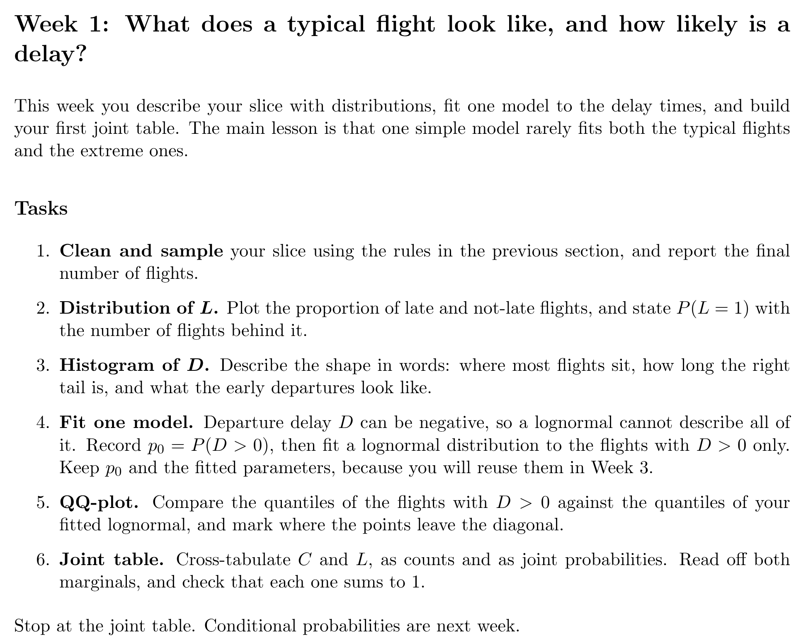

# Week 1 - Wrangle and Clean_Fit One Distribution

*use* [[week-1-progress-report]] *to capture any "commentary" (thoughts) you want to share on this week's work*

- [ ] <!--H35btM3Zjjziga2MyXKE9--> **1. Clean and sample** your slice using the rules in the previous section, and report the final number of flights [[w1t1]]
- [ ] <!--3g9iFH6bg42Ui6lLfZBVm--> **2. Distribution of L.** Plot the proportion of late and not-late flights, and state $P(L=1)$ with the number of flights behind it. [[w1t2]]
- [ ] <!--pkadJzc1rqgpXTrRp9iI9--> **3. Histogram of D.** Describe the shape in words: where most flights sit, how long the right tail is, and what the early departures look like. [[w1t3]]
- [ ] <!--XHGAx8SGvOiwB8Z9R-lv_--> **4. Fit on model.** Departure delay $D$ can be negative, so a lognormal cannot decribe all of it. Record $p_0 = P(D>0)$ then fit a lognormal distribution to the flights with $D>0$ only. Keep $p_0$ and the fitted parameters, because you will reuse them in Week 3. [[w1t4]]
- [ ] <!--EFZ4wUqQhEXIRvsnnbPKR--> **5. QQ-plot.** Compare the quantiles of the flights with $D>0$ against the quantiles of your fitted lognormal, and mark where the points leave the diagonal. [[w1t5]]
- [ ] <!--DCikCzS4M9xTBvMhcGyla--> **6. Joint table.** Cross-tabulate $C$ and $L$, as counts and as joint probabilities. Read off both marginals, and check that each one sums to 1. [[w1t6-joint-table]]